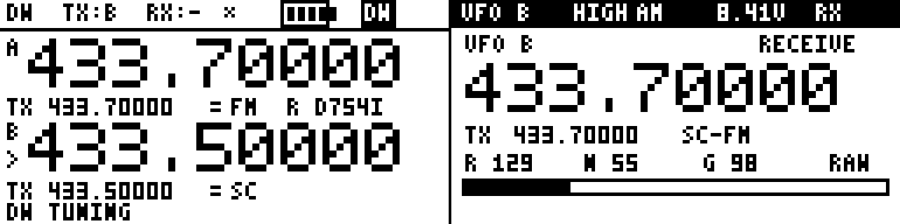
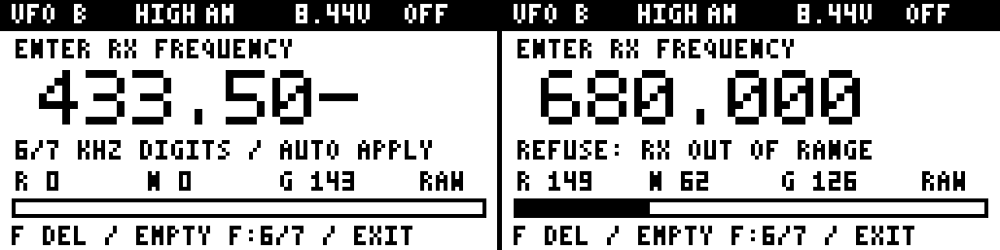
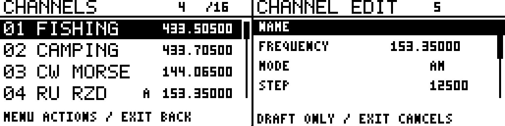
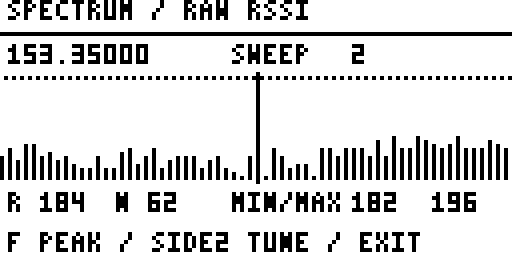
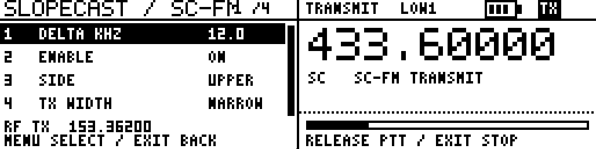

<h1 align="center">Trakt</h1>

<p align="center">
  
  
</p>

<p align="center">
  
  
  
  
</p>

Rust firmware for the Quansheng UV-K5 V3 with a PY32F071 MCU and BK4829 RF chip.

Trakt implements board-specific drivers, radio control, persistent settings, and a PowerShell development shell. The firmware has no third-party dependencies. Reference material from `armel/uv-k1-k5v3-firmware-custom` and the NR7Y CW firmware informs the register programming, wiring, and radio sequences.



## Features

- **Radio:** FM/NFM and AM/NAM reception, two independent VFOs, sixteen named channels, simplex/offset/split TX routes, and independent RX/TX CTCSS or DCS.
- **Reception:** extended frequency entry, carrier squelch, Monitor, VFO/channel scanning, Dual Watch, and an optional sequential Spectrum display.
- **Transmission:** factory PA-code profiles, battery and carrier admission, PTT release qualification, fixed attempt timeout, microphone AGC/compression, permit audio, and Roger tails.
- **CW:** carrier keying, shifted baseband reception, straight keys, Iambic A/B, passive USB-C paddles, 5-35 WPM, local practice, decoded RX/TX text, and configurable full break-in.
- **FSK link:** status packets, addressed text messages, a bounded inbox, and optional acknowledgements.
- **Storage:** checked Save/Load, RAM reset, dirty-state tracking, selectable autosave policy, and alternating committed records.
- **Interface:** selectable Home layouts and rows, frequency/name presentation, battery and signal displays, UI feedback, and microphone-level visualization.
- **Host tools:** versioned builds, ELF/BIN validation, memory accounting, UART screenshots, channel-bank exchange, and production-code host tests.

SlopeCast adds shifted FM transmission from an AM receive profile. VOX provides automatic voice transmission in non-CW compositions. CW compositions retain manual FM/NFM operation and omit operational VOX.

## Firmware variants

Variants select firmware composition independently of the Cargo `dev` and `release` optimization profiles.

| Variant | Tools | Spectrum | UART | SlopeCast | FSK | CW | VOX |
|---|---|---|---|---|---|---|---|
| `full` | Basic | Yes | Yes | No | No | No | Yes |
| `full-fam` | Basic | Yes | Yes | Yes | No | No | Yes |
| `radio` | Hidden | Yes | Yes | No | No | No | Yes |
| `compact` | Hidden | No | Yes | No | No | No | Yes |
| `standalone` | Hidden | No | No | No | No | No | Yes |
| `debug` | Extended | No | Yes | No | No | No | Yes |
| `fsk` | Hidden | No | Yes | No | Yes | No | Yes |
| `fsk-debug` | Extended | No | Yes | No | Yes | No | Yes |
| `cw` | Hidden | No | Yes | No | No | Yes | No |
| `cw-debug` | Basic + CW inputs | No | Yes | No | No | Yes | No |

Basic Tools contains **Stack, Power, Last fault, and UART**. Extended Tools adds input, calibration, receiver, timing, memory-layout diagnostics, and controlled recovery tests. `cw-debug` adds a dedicated CW input observation screen. `System > About` and `System > Controls` remain available in every variant.

The `debug` and `fsk-debug` variants include `debug-tools`. The `full-fam` variant includes `fam`; other named variants retain AM/NAM as receive-only profiles.

Saved preferences are preserved across variant changes, including choices for modules absent from the running image. Every variant retains RF control verification, watchdog service, stack guards, fault capture, and the TX cutoff.

## Frequencies and modulation

Receive tuning covers **50 MHz to below 630 MHz**, and **840 MHz through 1300 MHz inclusive**. The 630-840 MHz gap is excluded.

The LOW receiver path covers 50-279.99999 MHz. HIGH covers 280-629.99999 MHz and 840-1300 MHz. The two HIGH intervals have separate stepping and scan bounds despite sharing a hardware path. Sensitivity and image rejection across the extended coverage remain uncharacterized.

- **Representation:** integer hertz on a ten-hertz grid. Direct keypad input uses whole kHz; stepping and imported profiles can retain finer values.
- **Voice tuning steps:** 12.5, 25, and 100 kHz.
- **CW tuning step:** 100 Hz, with the saved voice step retained.
- **Path recall:** each VFO retains another-path position. The Band setting recalls that position.
- **Modulation:** explicit FM, AM, or available CW selection. Voice width selects FM/NFM or AM/NAM presets.
- **TX coverage:** 136-174 MHz and 400-470 MHz, subject to route resolution, policy, calibration, and edge margins.

Manual stepping stops at the current interval boundary. Direct frequency entry can select another interval and preserves the selected modulation.

Aviation channel numbering and an 8.33 kHz tuning grid remain outside the implemented tuning vocabulary. CW reception uses the baseband path described below; a general SSB operating mode is unavailable.

### Frequency entry

A complete admitted candidate applies automatically on its final digit. Reception is suspended while the field is open; the live frequency remains unchanged until acceptance.

Six digits enter frequencies below 1000 MHz: `050000`, `433500`, and `840000` select 50.000, 433.500, and 840.000 MHz. Seven digits permit values such as `1000000` and `1300000`. The editor initially selects seven digits when opened at 1000 MHz or above.

- **F with an empty field:** toggle six/seven digits. The preview shows the selected length.
- **F with digits present:** delete the final digit.
- **Rejected complete input:** retain the candidate and show REFUSE; another digit starts a new candidate of the same length.
- **Exit:** discard the candidate. Menu on incomplete input reports refusal.

The input length is explicit: `100000` is a complete 100 MHz value in six-digit mode and an incomplete candidate in seven-digit mode. Arithmetic and receive-range checks precede acceptance.

Channel and scan-range editors automatically accept the numeric field only. Their complete drafts still require Apply.



## Main controls

- **Menu / Exit:** open settings / disable requested RX on Home. Within editors, Exit cancels the current field or draft.
- **Up / Down:** tune the selected VFO or change the channel slot.
- **Digits:** start frequency input. Within menu lists, 1-9 select the corresponding displayed row; Zero selects row 10 where available.
- **F:** a short press and release selects A/B; holding it toggles Monitor during ordinary voice operation. Frequency editors assign F to deletion and input-length selection.
- **Star / Side2 / Side1:** select VFO or channel mode / toggle requested RX / toggle backlight.
- **PTT:** request manual voice transmission through the transmitter's admission checks.

CW Home assigns the selected local contacts to keying and opens the native CW menu directly. Its configurable Seven shortcuts provide access to the envelope, receive controls, settings, and text clearing.

Menu edits retain a candidate until accepted. A repeated Menu event cannot confirm storage or destructive actions. During an engaged transmission, a fresh Exit press requests cancellation.

## VFOs and channels

VFO A and B independently retain frequency, modulation, voice width, voice step, TX route, directional signaling, and another-path position. Channel recall leaves both VFOs unchanged. An empty channel slot disables reception and supplies no transmit destination.

The bank contains sixteen fixed twenty-byte slots. Each populated slot stores a complete FM/NFM/AM/NAM profile and eight printable ASCII name bytes. CW is a VFO modulation choice; storing a CW VFO into the current channel format is refused.

- **Use and Edit:** Use recalls the selected profile; Edit opens a detached draft. Exiting its list discards the draft.
- **Copy and Move:** Copy preserves the source and replaces the destination after confirmation. Move transfers into an empty slot or exchanges two occupied slots.
- **Delete and Store VFO:** Delete clears a RAM slot. Store VFO replaces its profile while preserving an existing name; an empty destination receives a space-padded name.

Channel editing and bank mutation disable requested RX. Cancelling a channel draft leaves RX disabled until the operator enables it again. Bank operations affect RAM; persistent writes follow the selected saving policy.

In the name editor, Up/Down selects a character, F advances, Star moves back, and digits insert directly. Imported printable punctuation remains intact until its cell is edited.



### Transmit routing

Simplex follows RX. Plus and Minus retain a positive offset up to 70 MHz; Split stores an explicit frequency in the TX envelope; RX-only disables transmission.

Offsets use ten-hertz units and survive later RX tuning. An invalid effective destination produces a refusal while preserving the stored route for subsequent tuning.

Ordinary AM/NAM profiles are receive-only regardless of their saved route. SlopeCast requires an enabled AM simplex profile. CW transmission also requires Simplex.

### Signaling

Each direction independently selects Off, CTCSS, DCS normal, or DCS inverted. The catalogs contain fifty CTCSS frequencies from 67.0 to 254.1 Hz and 104 DCS codes.

CTCSS uses catalog selection. DCS also accepts three octal digits; partial input, uncatalogued codes, and digits 8/9 are refused.

FM carrier detection remains independent of signaling-controlled audio. A mismatched code can mute the speaker while carrier admission reports a busy channel. Monitor bypasses both audio conditions; SQL zero bypasses carrier squelch while retaining an enabled signaling filter.

AM/NAM and CW suspend signaling for their operational receive paths. The saved directional choices remain available when the VFO returns to FM.

## Receive squelch

FM uses the complete factory RSSI/noise/glitch threshold row. AM uses an independent RSSI scale: level 1 opens at 160 raw counts, each subsequent level adds sixteen, and the closing threshold is eight counts below opening. Thus SQL 3 uses 192/184 and SQL 9 uses 288/280.

Opening requires sixty observed ticks of accepted samples; closing requires failure for 120 ticks. A sample gap above 100 ticks discards detector history. Mode changes reconfigure reception with fresh histories.

The AM scale applies to both widths and all admitted intervals. Signals below its selected threshold remain muted. Noise and glitch remain available as raw observations.

Monitor and SQL zero clear carrier history. Their bypass audio state is kept separate from the detected-carrier state used by TX admission.

CW uses the same independent RSSI scale for carrier admission, together with its separate decoder and speaker envelope.

## Scanning and Dual Watch

### Scanning

VFO scanning uses checked bounds in one contiguous RX interval. If the saved range belongs to another interval, scanning uses the current interval's limits. Channel scanning requires at least two populated slots outside the skip mask.

- **Timing:** dwell selections are 200/300/500/1000 ticks; hold selections are 300/500/1000/2000 ticks.
- **Traversal:** ascending or descending, with a saved per-channel skip mask.
- **Resume:** carrier-controlled, timed, or stop-on-carrier.
- **Cancellation:** PTT, manual tuning, frequency entry, Monitor, SQL zero, RX failure, or disabled reception stops the scan.

Dwell begins after the requested profile settles. Carrier observations control hold independently of CTCSS/DCS speaker admission. CW VFO scanning is unavailable.

### Dual Watch

Dual Watch alternates A/B through one physical receiver while keeping the selected VFO as the TX selection. A silent settled profile dwells for 300 ticks; carrier activity holds that destination until 500 ticks after the last open observation.

PTT pins reception to the selected VFO. A DW transmission attempt collects fresh selected-profile carrier observations for at least 120 ticks, with a fixed 1000-tick acquisition deadline.

The enabled preference is saved. Temporary listening position and timers are runtime state. Channel mode, editing, scanning, and other ineligible modes pause watching while preserving the preference.

When the selected VFO uses FM or AM, the other VFO may use CW. That CW destination receives with AUTO gain and an RSSI-gated speaker. Selecting the CW VFO pauses DW on its frequency so keying, decoding, and break-in share one stable receive destination.

Full break-in listens to the selected CW frequency between marks. It keeps the second VFO outside those short receive windows.

### Spectrum

Spectrum takes up to sixty-four sequential RSSI observations around the selected frequency. Every point waits for settled reception and a new sample. The receiver remains muted during sweeps and paused inspection.

- **Menu and arrows:** pause/resume, or pause and select a point.
- **F and Side2:** select the strongest measured point, or apply the selected frequency to the active VFO.
- **Exit:** return without applying a sampled frequency.
- **Settings:** 12.5/25/100 kHz point spacing and independent RSSI/noise marker thresholds.

AM marker selection uses RSSI. Plot height follows the observed RSSI range. Each point has a 1000-tick deadline; failure stops the sweep. Saved tuning changes only when the operator applies a selected frequency.



## Transmission

A fresh debounced voice PTT press requires at least 100 observed ticks of preceding release. Holding PTT at startup, through a refusal, or after a timeout keeps transmission locked until release.

Admission checks the selected profile, receiver settling, carrier status, UI scope, route, frequency policy, calibration, battery freshness, and storage ownership. Monitor, scanning, SQL zero, disabled RX, and unsuitable screens exclude transmission.

CW contacts and automatic voice requests use their own input state machines while retaining the transmitter's RF admission and complete-attempt limits.

### Frequency policy and power

The default HAM filter admits frequency margins inside 144-146 MHz and 433-440 MHz. Disabling HAM removes that allocation filter while retaining the hardware envelope and other admission checks. The operator remains responsible for the applicable service and station authorization.

Wide and narrow TX use edge margins of 12.5 and 6.25 kHz. LPD/PMR grid labels provide frequency classification; their ERP limits and equipment requirements require separate verification.

Power selections are Low1-Low5, Medium1-Medium5, High1-High3, and MAX. They select subdivisions of factory PA-code rows. MAX uses the factory High row directly. Actual output power depends on the radio, frequency, supply, and load.

### Deadlines and refusals

Timeout choices are 15/30/60/90/120/180 seconds, with thirty seconds as default. One fixed budget covers acquisition, preparation, local audio, transmission, and eligible tails. CW receive windows remain inside that same session budget.

The SysTick backstop follows the same attempt start with an additional 1000 observed ticks. PA drive and RF links are removed before audio cleanup. RF-off verification precedes clearing the backstop.

TX errors appear for 2000 ticks, then their message and flashing indication expire. Extended diagnostics retain the last error. A held input keeps its release lock independently of notification expiry.

### Microphone processing and audio

- **MIC AGC:** hardware microphone automatic gain, enabled by default.
- **TX compression:** optional hardware 2:1 compressor profile, disabled by default.
- **UI feedback:** Off, keys, actions, or all. Enabled modes retain a distinct double refusal cue.
- **Permit:** a local cue before PA admission.
- **Roger:** single, paired, triple tone patterns, or a fixed hardware-FSK MDC pattern.

Microphone processing applies to manual voice and automatic voice transmission. CW and automatic FSK acknowledgements use their own muted modulation paths. Synthetic voice tails release microphone compression before tone or packet generation.

Local UI cues use exclusive audio/RF ownership and expire after 250 ticks if playback remains ineligible. Roger follows normal release when sufficient attempt time remains. Cancellation, timeout, battery failure, and other errors end the attempt without Roger.

### VOX

VOX is available in non-CW firmware compositions for ordinary FM/NFM Home operation. Its settings are Enable, raw comparator threshold, and Hold.

- **Threshold:** 1-2047; lower values increase sensitivity. Default 128.
- **Hold:** 1-10 seconds after the last voice observation. Default three seconds.
- **Enable:** Off by default.
- **Graph:** detached threshold editing with decimal input and 1/16/256-count arrow steps.

The BK4829 comparator supplies voice/quiet events. Ten ticks of advancing voice observations qualify an initial request. Unknown detector state waits for an event. A cancelled active request requires a fresh quiet observation before another voice request.

Automatic voice starts without permit audio and can use the selected Roger after normal hold completion. Physical PTT cancels the automatic attempt. Carrier admission, calibration, battery, storage, and the original TOT remain active.

CW images omit the VOX menu, graph, comparator owner, and automatic voice path, including when their active VFO uses FM. Saved VOX choices remain preserved for use in another composition.

## CW

CW is available in `cw` and `cw-debug`. Select it through the active VFO's Modulation setting. Each VFO retains its CW selection independently, together with its saved voice width and step.

The transmitter keys the carrier with microphone sampling and TX modulation muted. Reception uses a narrow baseband path tuned below nominal by the selected pitch, producing a local receive tone from an incoming carrier.

### Keying and settings

- **Key:** Straight contact 1, Straight contact 2, Iambic A, or Iambic B.
- **Paddles:** Normal or Reverse dot/dash assignment.
- **Speed:** 5-35 WPM, default 15. The keyer and RX/TX decoders share this selection.
- **Tone:** 400-1000 Hz in 100 Hz steps, default 700 Hz.
- **Tone volume:** local sidetone gain code 0-127, default 28; zero disables Tone1.
- **TX hang:** 50/100/200 ms or 300-1500 ms in 100 ms steps, default 700 ms.
- **QSK:** On for RF operation; Off for local practice.
- **Input:** Local or USB Key. `cw-debug` additionally exposes USB Test.

Local contact 1 is PTT; contact 2 is Side1. Straight modes use the selected contact. Iambic modes use both contacts and optionally reverse their dot/dash assignment.

A dot lasts round(1200 / WPM) observed milliseconds. Dashes last three units and automatic element gaps last one unit. Dot units are 48 ms at 25 WPM, 40 ms at 30 WPM, and 34 ms at 35 WPM.

Opposite-paddle taps are remembered during an element and its gap. Releasing a squeeze in Iambic A completes the current element; Iambic B retains an additional opposite element. Pending electronic marks keep their full duration and begin after checked TX readiness.

Contact assertions use a five-tick filter; release is immediate at the next sample. Entry and cancellation require both selected contacts released for 100 ticks. Input loss, RF errors, setting changes, or a foreground service gap above twenty ticks discard live keyer state.

Initial TX preparation retains one released straight-key attack for replay after readiness. Subsequent straight keying follows the live contact. Unexpected new closures still require any necessary RF turnaround.

### USB-C paddles

The passive adapter connects:

- **Tip:** USB D+, PA12.
- **Ring:** USB D-, PA11.
- **Sleeve:** USB GND.

Use these contacts exclusively for the passive paddle connection. USB host and charger connections must be disconnected during paddle operation; VBUS, CC, and shield stay outside the paddle circuit.

CW images reserve PA11/PA12 as GPIO inputs and disable the inherited USB peripheral clock. Selecting USB Key enables their pull-ups. UART remains on PA9/PA10.

USB Test in `cw-debug` displays contacts while excluding transmission. Local and USB input selection remains explicit throughout a session.

### Receive controls and text

CW Home has separate committed RX/TX text lines and provisional Morse symbols. Each committed line contains eighteen fixed cells; the next character starts a new line after it fills.

The RX decoder consumes a qualified RSSI envelope sampled at a nominal five-tick cadence. Its threshold is adjustable from 1 to 511 raw counts, default 160, with four counts of closing hysteresis. The optional gated speaker follows this envelope; Open audio provides continuous CW reception.

RF gain selects AUTO or one of five fixed receiver table positions. TX acquisition uses fresh AUTO-gain carrier observations and the independent carrier threshold.

TX text follows the completed keying state. Decoder speed follows the selected WPM; timing gaps and interrupted observations discard partial symbols while preserving committed text. Full-break-in speaker windows keep RX text suspended during the engaged TX session.

Seven tap and hold can open the envelope display, native gain/volume/threshold editor, CW settings, or clear text. Defaults retain normal numeric entry on tap and the envelope display on hold. The envelope screen continues reception with transmission excluded.

### Break-in

The Break-in setting selects **SEMI** or a **FULL** receive-window mode. QSK remains the separate RF/practice selection.

- **SEMI:** TX stays prepared between elements. After keyer inactivity, the selected TX hang ends the session and restores ordinary RX.
- **FULL:** every completed mark starts a transition toward RX without an additional RF hang. The logical session, keyer memory, and original TOT remain active.
- **FULL RX wait:** 50/25/10/5/2/1/0 ms before checked receive AF admission. The setting controls one part of the transition; audio fades, register programming, and TX preparation also occupy time.

In FULL, a held paddle or remembered element requests TX preparation before its scheduled gap ends. The preparation lead follows the session's observed turnaround time. PA remains off until the separate mark request and completed TX checks.

The external amplifier stays powered through the session. DAC-gain fades surround AF changes, and the oscillator is released after the output reaches zero. Two local controls allow comparison:

- **Tail shape:** LINEAR, SOFT, or SMOOTH within the existing four-step falling fade.
- **Tone release:** 0-4 ms at zero output gain before clearing oscillator frequency.
- **Defaults:** LINEAR and 2 ms.

Higher release values consume more receive-window time. Shape changes preserve the existing fade-step cadence. Semi-break-in and practice retain their ordinary sidetone release behavior.

The radio receives another operator only during its available RX windows. At higher WPM, turnaround and audio preparation occupy a larger fraction of the gap. Listening stays on the selected CW frequency; DW remains paused.

Full break-in has been exercised on two UV-K5 V3 radios. Testing showed usable sidetone and received keying, with residual local switching crackle. Tail controls provide an operator-selectable compromise between that transient and the available receive interval.

## FSK link

The `fsk` and `fsk-debug` variants add a four-tab application: Compose, Inbox, Settings, and Status. F cycles tabs. The application selects narrow FM reception and keeps the saved voice profile intact.

### Messages and status

- **Local address:** 001-999, default 001.
- **Destination:** 001-999 or 000 for broadcast.
- **Text:** up to fifty-two printable ASCII bytes.
- **Inbox:** four messages in arrival order, with retained sender/sequence duplicate suppression.
- **Status:** CHECK, RECEIVED, COME HERE, WAIT, READY, or CANCEL.

Compose Menu selects the local address, destination, or text field. Addresses accept three decimal digits; arrows adjust the selected value. Text uses numeric multi-tap entry and arrow character selection.

Star release advances the text cursor; holding Star moves backward. Side2 release deletes the current character; holding it clears the draft. Inbox Menu prepares a reply to the selected sender; Zero clears the inbox.

Manual PTT starts an admitted voice attempt and sends one captured packet on normal release. Releasing PTT during preparation ends the attempt before packet transmission. Inbox and Settings reserve PTT for cancellation of any automatic response.

Packets carry a nonzero sequence, checked framing, and software CRC. The hardware FIFO uses a seventy-two-byte nominal 1200-bit/s profile.

### Acknowledgements

ACK On requests confirmation for addressed messages and allows automatic responses to requests addressed to the current local ID. Broadcasts remain outside the acknowledgement exchange.

A completed manual message starts a three-second confirmation wait. A matching sender, destination, and sequence produces CONFIRMED. Expiry produces NO REPLY. Manual messages have no automatic retransmission.

One automatic acknowledgement can wait for admission for up to 2500 ticks. It uses quiet-channel acquisition, policy, calibration, battery, and complete RF-off cleanup. Physical PTT cancels it.

SENT reports local packet completion. CONFIRMED reports a matching received acknowledgement; addresses are unauthenticated. Drafts, addresses, inbox entries, ACK selection, and sequences remain volatile.

## SlopeCast

SlopeCast is selected by the `fam` feature and exposed in `full-fam` at `Radio > SlopeCast`. Reception stays AM; an enabled AM simplex profile transmits FM at a configured offset from its nominal frequency.

- **Enable and Side:** Off by default; LOWER or UPPER selects the offset direction.
- **Delta:** 0.1-50.0 kHz, default 5.0 kHz. F switches the edit increment between 1.0 and 0.1 kHz.
- **TX width:** existing WIDE/NARROW FM presets, independent of AM receive width.
- **Routing:** Simplex is required. RX-only stays disabled; offset and split routes are refused.

For nominal 433.500 MHz, LOWER with Delta 4.0 kHz resolves to 433.496 MHz. The settings page shows this RF TX frequency. The main display retains nominal frequency and identifies the transmission as SC-FM.

SlopeCast relies on the receiving equipment's filter slope to convert frequency variation into amplitude variation. Suitable offset and audio quality depend on that receiver. Deviation uses the existing FM preset.

Both nominal and shifted frequencies pass TX policy; calibration uses the shifted frequency. Release and cancellation restore the original AM receiver through the ordinary shutdown and initialization paths.

SC-FM suspends transmitted CTCSS/DCS and Roger while retaining their saved choices. Local permit audio remains available. Carrier, battery, PTT release, storage, and timeout checks remain active.

SlopeCast settings survive variant changes and become operational again when `fam` is present.



## Display

Presentation settings affect drawing independently of RF admission.

- **Ordinary Home:** Clean/Panel/Detail layout and frequency or channel-name primary field.
- **Rows A/B/C:** independent assignments for profile, TX route, signal, battery, other VFO, uptime, meter, automatic content, or hidden rows.
- **Indicators:** hidden/bar/segmented RX meter, battery icon/voltage/hidden, and TX amplitude level/history/off.
- **Navigation:** cursor/inverse/outline selection, optional hints, refresh period, and saved backlight choice.
- **CW Home:** dedicated frequency, key status, committed text, provisional symbols, and operating footer.
- **FSK:** fixed tabs with addresses, text, ACK status, and a receive indicator.

Normal refresh requests occur every 125/250/500 ticks. Input and notification changes request additional composition. Voice-TX visualization requests updates after fifty ticks; active CW, its envelope screen, and the VOX graph request updates after twenty-five ticks.

Rendering uses one 128x64 page-ordered framebuffer and an immutable glyph catalog. Full-frame transport sends 1048 bytes including page commands. A busy LCD drains its current frame before the next composition.

Microphone visualization reads `REG_64` during voice TX and retains a display level, peak, raw extrema, and sixty-four-point history. Battery voltage uses an integer conversion from acquired factory calibration. RSSI uses the raw nine-bit indicator scale.


## Persistent settings

Save captures the complete settings snapshot and commits it through the journal. Load and boot inspection read validated records without migration writes.

- **Save / Load:** commit current settings and channels, or restore a validated record and request RX.
- **Reset RAM:** restore defaults and clear channels while retaining saved sectors.
- **Test torn:** verify an uncommitted body while preserving an existing valid record. Available outside ordinary `cw`, including `cw-debug`.
- **Saving policy:** No Auto, Warn, or Auto. Warn offers Save when leaving changed settings; Auto schedules the ordinary journal operation when eligible.

Saved global choices include HAM, Dual Watch, microphone processing, VOX, SlopeCast, CW keying/receive controls, break-in, and local tail options. Both VFOs and all populated channel profiles are included.

The dirty marker compares RAM with the accepted settings baseline. Successful committed Save and validated Load accept a new baseline. Runtime RX admission, Monitor, scan progress, temporary DW position, decoder text, and live keying state are excluded.

Auto waits at least 2000 ticks after a settings interaction and applies a thirty-second attempt cooldown. An automatic write failure blocks further automatic attempts until validated Load or successful Save.

### Journal layout

Records occupy external-Flash sectors `0x197000` and `0x198000`. Each sector begins with a 512-byte record containing a 448-byte payload, CRC32, and a separately programmed commit word.

Current journal format is **27**; channel wire schema is **9**. Historical formats retain their assigned field restrictions. Records preceding format 27 retain a maximum saved CW speed of 25 WPM; defaults still select 15 WPM.

Save targets the inactive sector and verifies erase, body readback, commit, calibration comparison, and write-disable completion. Both complete sectors are inspected before reclamation. Unknown formats or occupied tails block writing.

Factory calibration at external-Flash address `0x010000` remains read-only. Acquisition compares two complete reads; journal completion compares the calibration CRC with the acquired block.

Load restores the saved backlight state, including Off. Side1 toggles it during ordinary operation; a local CW Side1 contact follows its keying assignment on CW Home. Persistence follows the selected saving policy.

## Development shell

Start `.\shell.ps1` from the project root on Windows. Requirements are PowerShell 7.3+, Cargo/rustc, and the installed `thumbv6m-none-eabi` target libraries. Git is optional.

The manifest contains an empty `[dependencies]` table and disables automatic build-script discovery. Cargo runs offline and locked. Target libraries and `rust-lld` come from the selected Rust toolchain. External compiler wrappers and profile overrides are rejected.

### Build and validation commands

```text
ci
ci --variant=cw
ci --variant=full-fam
ci --ignore-increment --variant=cw

build release --variant=cw
check release --variant=cw
inspect release --variant=cw
frames release --variant=cw
size release --variant=cw
```

- **CI:** source/dependency audit, host tests, and dev/release builds for the selected variants under one reserved identity. The default selects the complete named matrix.
- **Build:** links, validates, and exports one image. Its default profile is dev and default variant is full.
- **Check:** checks target code while leaving the version unchanged.
- **Inspect:** verifies source/toolchain fingerprints, artifact hashes, ELF/BIN agreement, and memory accounting.
- **Frames:** emits separate diagnostic assembly and selected function prologues.
- **Size:** attributes Flash use through a separate enlarged analysis link, including images which exceed the installation region. Its output stays in the analysis directory.

Host tests execute production keyer, decoder, packet, memory-copy, and other pure code, together with register models for local-audio and comparator owners. Radio behavior is tested separately on the hardware.

After host functions or classes change, start a fresh PowerShell session. Firmware-only edits can use the existing shell session.

The shell supports `&&`, `||`, and `;`, persistent aliases, history, Ctrl+R search, and the Ctrl+P command palette.

### Version identity

`version.json` and `src/build_info.rs` define firmware identity. Cargo package version is independent.

- An ordinary build increments patch; CI reserves one number for its selected matrix.
- `assign NAME` increments minor and resets patch without compiling. `ci --assign=NAME` builds the assigned `.0`.
- `--ignore-increment` repeats the current identity for corrective builds.
- Failed builds retain their reserved number.

Check, Inspect, Frames, and Size leave the version number unchanged.

### Artifacts and memory

The default full release image is `target/artifacts/release/trakt.bin`. Other variants use `target/artifacts/<variant>/release/trakt.bin`; ELF and JSON reports are stored alongside the BIN.

The application starts at MCU Flash address `0x08002800` within a 118 KiB linker region. SRAM is 16 KiB. Stack reservation is 8192 bytes: 7168 for main execution and 1024 for the fault path. A separate sixty-four-byte retained record occupies the top of SRAM.

Reports distinguish ELF file size, BIN extent, Flash load, gaps, static RAM, and reserved stack. Diagnostic/Spectrum/UART figures are subsets of static RAM. Runtime watermarks show observed stack usage; function prologues show local stack allocations.

Build tools validate artifacts and export files. Radio flashing and RF/audio testing remain separate operations.

## UART tools

UART-enabled variants use 38400 baud, 8N1, with no hardware flow control. Host tools leave DTR/RTS disabled.

```text
shot COM7 --out .trakt_trace/screens/home.png --scale 4
shot capture.fb --out capture.png

channels export COM7 channels.json
channels validate channels.json
channels import COM7 channels.json

calib calibration.bin
calib dump.bin --offset 0x10000
```

- **Screenshots:** CRC-checked completed framebuffer capture, PNG conversion, and raw `.fb` output. Capture waits until TX ownership is released.
- **Channel export:** current bank as checked JSON, with overwrite protection for existing output files.
- **Channel import:** schema validation and staging, followed by Menu/Exit confirmation on the radio.
- **Calibration inspection:** read-only decoding of a 512-byte block or an explicitly selected dump range.

Current channel JSON uses schema 9, capacity sixteen, integer hertz fields, FM/NFM/AM/NAM modes, explicit TX routes, and directional signaling objects. Supported older schemas are checked against their original restrictions.

Import replaces all sixteen RAM slots; omitted slots become empty. Global settings remain unchanged, and channel scan exclusions are cleared. The radio acknowledges staging before local confirmation and committed saving. Imports require an explicit new attempt after failure.

Screenshots are unavailable throughout an engaged CW session, including its full-break-in receive windows.

## Diagnostics and recovery

Basic Tools provides the observations useful during normal operation:

- **Stack:** sampled main/fault usage, reservations, guards, and tick gaps.
- **Power:** averaged/raw battery estimates and calibration reference.
- **Last fault:** retained reason, exception, frame validity, PC/LR, and reset flags.
- **UART:** transport counters, errors, status, DMA remainder, and RX level.

Extended Tools adds detailed driver and timing screens plus fault, watchdog, and application-reentry tests. Tests require parked RF, idle storage, and released PTT. They terminate the running application, discarding unsaved RAM changes.

`cw-debug` provides CW inputs, cached RSSI and envelope thresholds, qualified mark/space durations, maximum sampling interval, and the observed initial request-to-ready interval.

The common failure path disables RF and stops watchdog service. Retained fault data is checksum-validated at startup. Its survival across the loader depends on the loader's SRAM handling.

SysTick supplies nominal millisecond ticks. Interrupt masking across multiple periods can lose increments. Foreground deadlines use this observed counter, while the independent watchdog covers stalled foreground service.