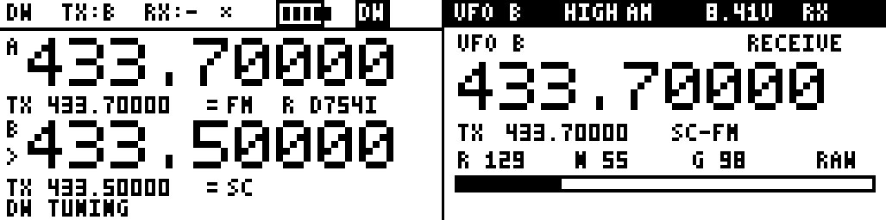
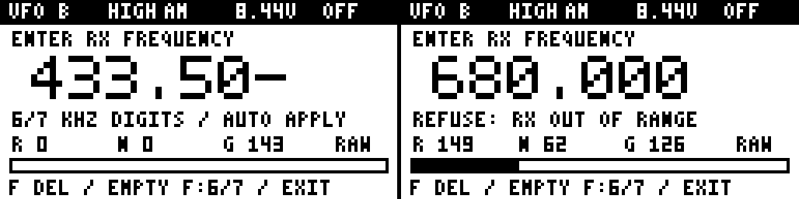
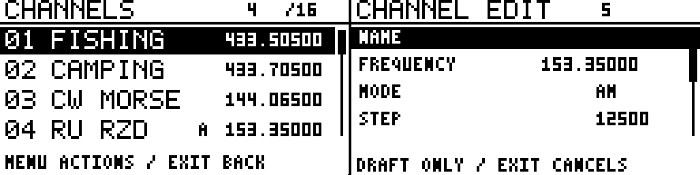
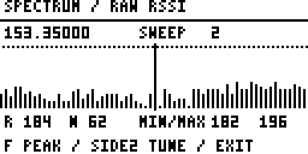
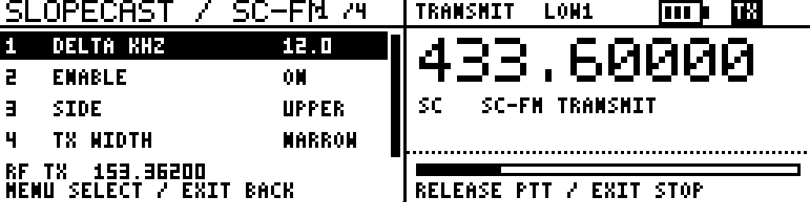

<h1 align="center">Trakt</h1>

<p align="center">
  
  
</p>

<p align="center">
  
  
  
  
</p>

Rust firmware for the Quansheng UV-K5 V3 with a PY32F071 MCU and BK4829 RF chip.

Trakt implements board-specific drivers, radio control, persistent settings, and a PowerShell development shell. The firmware has no third-party dependencies. Register values, wiring, and hardware sequences are checked against `armel/uv-k1-k5v3-firmware-custom`.



## Features

- **Radio:** FM/NFM and AM/NAM reception, two independent VFOs, sixteen named channels, simplex/offset/split TX routes, and independent RX/TX CTCSS or DCS.
- **Reception:** extended frequency entry, carrier squelch, Monitor, VFO/channel scanning, Dual Watch, and an optional sequential Spectrum display.
- **Transmission:** calibrated PA-code profiles, battery and carrier admission, PTT release qualification, fixed attempt timeout, local permit audio, and Roger tails.
- **Storage:** checked Save/Load, RAM reset, dirty-state tracking, selectable autosave policy, and alternating committed records.
- **Interface:** selectable Home layouts, frequency/name presentation, battery and signal displays, UI feedback, and microphone-level visualization.
- **Host tools:** versioned builds, ELF/BIN validation, memory accounting, UART screenshots, and checked channel-bank exchange.

The optional SlopeCast feature supports shifted FM transmission from an AM receive profile. SSB, CW, and external Morse-key support remain unimplemented.

## Firmware variants

Variants select firmware composition independently of the Cargo `dev` and `release` optimization profiles.

| Variant | Tools | Spectrum | UART | SlopeCast |
|---|---|---|---|---|
| `full` | Basic | Yes | Yes | No |
| `full-fam` | Basic | Yes | Yes | Yes |
| `radio` | Hidden | Yes | Yes | No |
| `compact` | Hidden | No | Yes | No |
| `standalone` | Hidden | No | No | No |
| `debug` | Extended | No | Yes | No |

Basic Tools contains **Stack, Power, Last fault, and UART**. Extended Tools adds input, calibration, receiver, timing, memory-layout diagnostics, and controlled recovery tests. `System > About` and `System > Controls` remain available in every variant.

The `debug` variant includes `debug-tools` and omits Spectrum. The `full-fam` variant includes `fam`; ordinary `full` retains the AM TX prohibition. Saved preferences belonging to absent modules remain validated and preserved across variant changes.

All variants retain RF control verification, watchdog service, stack guards, fault capture, and the TX cutoff.

## Frequencies and modulation

Receive tuning admits **50 MHz to below 630 MHz**, and **840 MHz through 1300 MHz inclusive**. The 630-840 MHz gap is rejected. These limits describe accepted tuning requests; receiver sensitivity and image rejection across the extended coverage are not characterized.

The LOW receiver path covers 50-279.99999 MHz. HIGH covers 280-629.99999 MHz and 840-1300 MHz. The two HIGH intervals have separate stepping and scan bounds despite sharing a hardware path.

- **Representation:** integer hertz on a ten-hertz grid. Direct keypad input uses whole kHz; stepping and imported profiles can retain finer values.
- **Tuning steps:** 12.5, 25, and 100 kHz. Stepping stops at the current interval boundary.
- **Path recall:** each VFO retains another-path position. The Band setting recalls that position.
- **Modulation:** FM or AM is selected explicitly. Width selects the corresponding wide/narrow preset, displayed as FM, NFM, AM, or NAM.
- **TX coverage:** 136-174 MHz and 400-470 MHz, subject to route resolution, policy, calibration, and edge margins.

Direct frequency entry can select another interval. Entering an aviation frequency preserves the current modulation. Aviation channel numbering and an 8.33 kHz tuning grid are not implemented.

### Frequency entry

A complete admitted candidate applies automatically on its final digit. Reception is suspended while the field is open; the live frequency remains unchanged until acceptance.

Six digits enter frequencies below 1000 MHz: `050000`, `433500`, and `840000` select 50.000, 433.500, and 840.000 MHz. Seven digits permit values such as `1000000` and `1300000`. The editor initially selects seven digits when opened at 1000 MHz or above.

- **F with an empty field:** toggle six/seven digits. The preview shows the selected length.
- **F with digits present:** delete the final digit.
- **Rejected complete input:** retain the candidate and show REFUSE; another digit starts a new candidate of the same length.
- **Exit:** discard the candidate. Menu on incomplete input reports refusal.

The input length is explicit: `100000` is a complete 100 MHz value in six-digit mode and an incomplete candidate in seven-digit mode. Invalid seven-digit values are rejected before multiplication can overflow.

Channel and scan-range editors automatically accept the numeric field only. Their complete drafts still require Apply.



## Main controls

- **Menu / Exit:** open settings / disable requested RX on Home. Within editors, Exit cancels the current field or draft.
- **Up / Down:** tune the selected VFO or change the channel slot.
- **Digits:** start frequency input. Within menu lists, 1-9 select the corresponding displayed row; Zero selects row 10 where available.
- **F:** a short press and release selects A/B; holding it toggles Monitor. Frequency editors assign F to deletion and input-length selection.
- **Star / Side2 / Side1:** select VFO or channel mode / toggle requested RX / toggle backlight.
- **PTT:** request transmission through the transmitter's admission checks.

Menu edits keep a candidate until accepted. Held Menu events cannot confirm storage or destructive actions. During an engaged transmission, a fresh Exit press requests cancellation.

## VFOs and channels

VFO A and B independently retain frequency, modulation, width, step, TX route, directional signaling, and another-path position. Channel recall leaves both VFOs unchanged. An empty channel slot supplies neither a receive profile nor a transmit destination.

The bank contains sixteen fixed twenty-byte slots. Each populated slot stores a complete profile and eight printable ASCII name bytes.

- **Use and Edit:** Use recalls the selected profile; Edit opens a detached draft. Exiting its list discards the draft.
- **Copy and Move:** Copy preserves the source and replaces the destination after confirmation. Move transfers into an empty slot or exchanges two occupied slots.
- **Delete and Store VFO:** Delete clears a RAM slot. Store VFO replaces its profile while preserving an existing name; an empty destination receives a space-padded name.

Channel editing and bank mutation disable requested RX. Cancelling a channel draft does not re-enable it automatically. Bank operations affect RAM; persistent writes follow the selected saving policy.

In the name editor, Up/Down selects a character, F advances, Star moves back, and digits insert directly. Unsupported imported punctuation remains intact until its cell is edited.



### Transmit routing

Simplex follows RX. Plus and Minus retain a positive offset up to 70 MHz; Split stores an explicit frequency in the TX envelope; RX-only supplies no destination.

Offsets use ten-hertz units and survive later RX tuning. If an effective offset destination becomes invalid, transmission refuses it without clamping or replacing the route. A valid stored route therefore does not imply that its current TX destination is admitted.

Ordinary AM/NAM profiles refuse transmission regardless of their stored route. SlopeCast has separate route restrictions.

### Signaling

Each direction independently selects Off, CTCSS, DCS normal, or DCS inverted. The catalogs contain fifty CTCSS frequencies from 67.0 to 254.1 Hz and 104 DCS codes.

CTCSS uses catalog selection. DCS also accepts three octal digits; partial input, uncatalogued codes, and digits 8/9 are refused.

FM carrier detection remains independent of signaling-controlled audio. A mismatched code can mute the speaker while the transmitter still sees a busy channel. Monitor bypasses both audio conditions; SQL zero bypasses carrier squelch while retaining an enabled signaling filter.

AM/NAM bypass saved RX signaling without erasing it. Returning to FM restores that selection.

## Receive squelch

FM uses the complete factory RSSI/noise/glitch threshold row. AM uses an independent RSSI scale: level 1 opens at 160 raw counts, each subsequent level adds sixteen, and the hold threshold is eight counts below opening. Thus SQL 3 uses 192/184 and SQL 9 uses 288/280.

Opening requires sixty observed ticks of accepted samples; closing requires failure for 120 ticks. A sample gap above 100 ticks discards detector history. Mode changes reconfigure reception with fresh histories.

The AM scale applies to both widths and all admitted intervals. Signals below its selected threshold remain muted. Noise and glitch stay available as observations but do not control AM squelch.

Monitor and SQL zero clear carrier history instead of reporting their open audio state as a detected carrier.

## Scanning and Dual Watch

### Scanning

VFO scanning uses checked bounds in one contiguous RX interval. If the saved range belongs to another interval, scanning uses the current interval's limits. Channel scanning requires at least two populated slots that are not skipped.

- **Timing:** dwell selections are 200/300/500/1000 ticks; hold selections are 300/500/1000/2000 ticks.
- **Traversal:** ascending or descending, with a saved per-channel skip mask.
- **Resume:** carrier-controlled, timed, or stop-on-carrier.
- **Cancellation:** PTT, manual tuning, frequency entry, Monitor, SQL zero, RX failure, or disabled reception stops the scan.

Dwell begins after the requested profile settles. Carrier observations control hold independently of CTCSS/DCS speaker admission.

### Dual Watch

Dual Watch alternates A/B through one physical receiver while keeping the selected VFO as the TX selection. A silent settled profile dwells for 300 ticks; carrier activity holds that destination until 500 ticks after the last open observation.

PTT pins reception to the selected VFO. A DW transmission attempt additionally collects fresh selected-profile carrier observations for at least 120 ticks, with a fixed 1000-tick acquisition deadline. The other VFO's history cannot qualify it.

The enabled preference is saved. Temporary listening position and timers are runtime state. Channel mode, editing, scanning, and other ineligible modes pause watching without clearing the preference.

### Spectrum

Spectrum takes up to sixty-four sequential RSSI observations around the selected frequency. Every point waits for settled reception and a new sample. The receiver remains muted during sweeps and paused inspection.

- **Menu and arrows:** pause/resume, or pause and select a point.
- **F and Side2:** select the strongest measured point, or apply the selected frequency to the active VFO.
- **Exit:** return without applying a sampled frequency.
- **Settings:** 12.5/25/100 kHz point spacing and independent RSSI/noise marker thresholds.

AM ignores the FM noise marker condition. Plot height follows the observed RSSI range. Each point has a 1000-tick deadline; failure stops the sweep. Sampling itself does not change saved tuning positions.



## Transmission

A fresh debounced PTT press requires at least 100 observed ticks of preceding release. Holding PTT at startup, through a refusal, or after a timeout cannot restart TX.

Admission checks the selected profile, receiver settling, carrier status, UI scope, route, frequency policy, calibration, battery freshness, and storage ownership. Monitor, scanning, SQL zero, disabled RX, and an unsuitable screen prevent admission.

### Frequency policy and power

The default HAM filter admits frequency margins inside 144-146 MHz and 433-440 MHz. Disabling HAM removes that allocation filter while retaining the hardware envelope and other checks. The firmware has no location or operator-authorization input.

Wide and narrow TX use edge margins of 12.5 and 6.25 kHz. LPD/PMR grid labels provide frequency classification without establishing power compliance or certification.

Power selections are Low1-Low5, Medium1-Medium5, High1-High3, and MAX. They select subdivisions of factory PA-code rows; MAX uses the factory High row without an additive boost. Output watts are not derived from these labels.

### Deadlines and refusals

Timeout choices are 15/30/60/90/120/180 seconds, with thirty seconds as default. One fixed budget covers acquisition, setup, permit audio, voice TX, and Roger. The SysTick backstop uses the same attempt start with an additional 1000 observed ticks.

PA drive and RF links are removed before audio cleanup. RF-off verification precedes clearing the backstop.

TX errors appear for 2000 ticks, then their message and flashing indication expire. The last error remains available to extended diagnostics. Holding PTT does not renew the notification; release qualification remains required.

### Audio

- **UI feedback:** Off, keys, actions, or all. Enabled modes retain a distinct double refusal cue.
- **Permit:** a local cue before PA admission.
- **Roger:** single, paired, triple tone patterns, or a fixed hardware-FSK MDC pattern.

Local UI cues use exclusive audio/RF ownership and can expire while playback is ineligible. Roger follows normal release only when sufficient attempt time remains. Cancellation, timeout, battery failure, and other errors produce no transmitted tail.

## SlopeCast

SlopeCast is selected by the `fam` feature and exposed in `full-fam` at `Radio > SlopeCast`. Reception stays AM; an enabled AM simplex profile transmits FM at a configured offset from its nominal frequency.

- **Enable and Side:** Off by default; LOWER or UPPER selects the offset direction.
- **Delta:** 0.1-50.0 kHz, default 5.0 kHz. F switches the edit increment between 1.0 and 0.1 kHz.
- **TX width:** existing WIDE/NARROW FM presets, independent of AM receive width.
- **Routing:** Simplex is required. RX-only remains disabled; offset and split routes are refused.

For nominal 433.500 MHz, LOWER with Delta 4.0 kHz resolves to 433.496 MHz. The settings page shows this RF TX frequency. The main display retains nominal frequency and identifies the transmission as SC-FM.

SlopeCast relies on the receiving equipment's filter slope to convert frequency variation into amplitude variation. Suitable offset and audio quality depend on that receiver. Dedicated deviation adjustment is not implemented.

Both nominal and shifted frequencies pass TX policy; calibration uses the shifted frequency. Saved RX tuning is unchanged. Release and cancellation restore the original AM receiver through the ordinary shutdown and initialization paths.

SC-FM suppresses transmitted CTCSS/DCS and Roger without changing their saved choices. Local permit audio remains available. Carrier, battery, PTT release, storage, and timeout checks remain active.

SlopeCast settings survive installation of a variant without `fam`; those variants retain the AM TX prohibition.



## Display

Presentation settings affect drawing independently of RF admission.

- **Home:** Clean/Panel/Detail layout, frequency or channel-name primary field, and a secondary row for profile, signal, battery, other VFO, uptime, or nothing.
- **Indicators:** hidden/bar/segmented RX meter, battery icon/voltage/hidden, and TX amplitude level/history/off.
- **Navigation:** cursor/inverse/outline selection, optional hints, refresh period, and saved backlight choice.

Normal refresh requests occur every 125/250/500 ticks. Input and notification changes request additional composition; voice-TX visualization also requests updates after fifty ticks. A busy LCD drains its current frame before a pending replacement is drawn.

Rendering uses one 128x64 page-ordered framebuffer and an immutable glyph catalog. Full-frame transport sends 1048 bytes including page commands. Refresh periods describe request scheduling rather than guaranteed completed-frame rates.

Microphone visualization uses the chip's amplitude indicator with display-level, peak, and sixty-four-point history. Battery voltage uses an integer conversion from acquired factory calibration. RSSI, microphone levels, and voltage estimates retain their respective raw or derived units.

## Persistent settings

Save captures the complete settings snapshot and commits it through the journal. Load and boot inspection perform no migration write.

- **Save / Load:** commit current settings and channels, or restore a validated record and request RX.
- **Reset RAM:** restore defaults and clear channels without altering saved sectors.
- **Test torn:** verify an uncommitted body while preserving an existing valid record.
- **Saving policy:** No Auto, Warn, or Auto. Warn offers Save when leaving changed settings; Auto schedules the ordinary journal operation when eligible.

The dirty marker compares RAM with the accepted settings baseline. Successful committed Save and validated Load accept a new baseline. Runtime RX admission, Monitor, scan progress, and temporary DW position are excluded.

Auto waits at least 2000 ticks after a settings interaction and applies a thirty-second attempt cooldown. An automatic write failure blocks further automatic attempts until validated Load or successful Save.

### Journal layout

Records occupy external-Flash sectors `0x197000` and `0x198000`. Each sector begins with a 512-byte record containing a 448-byte payload, CRC32, and a separately programmed commit word. Save targets the inactive sector and verifies erase, body readback, commit, and write-disable completion.

Both complete sectors are inspected before reclamation. Unknown record formats or occupied tails block writing. Current journal format is 19; channel wire schema is 9. Historical formats retain their original field restrictions.

Factory calibration at external-Flash address `0x010000` remains read-only. Acquisition compares two complete reads; journal completion also verifies its CRC against the acquired block.

Load restores the saved backlight state, including Off. Side1 turns it on; persistence follows the selected saving policy.

## Development shell

Start `.\shell.ps1` from the project root on Windows. Requirements are PowerShell 7.3+, Cargo/rustc, and the installed `thumbv6m-none-eabi` target libraries. Git is optional.

The manifest contains an empty `[dependencies]` table and disables automatic build-script discovery. Cargo runs offline and locked. Target libraries and `rust-lld` come from the selected Rust toolchain; external compiler wrappers and profile overrides are rejected.

### Build and validation commands

```text
ci
ci --variant=full-fam
build release --variant=full
check release
inspect release
frames release
```

- **CI:** source/dependency audit, host tests, and dev/release builds for the selected variants under one reserved identity.
- **Build and Check:** Build links, validates, and exports one image; Check validates target code without linking or allocating a version.
- **Inspect:** verifies source/toolchain fingerprints, artifact hashes, ELF/BIN agreement, and memory accounting.
- **Frames:** emits separate diagnostic assembly and selected prologues without approving or exporting a firmware image.

After host functions or classes change, start a fresh PowerShell session. Firmware-only edits do not require reloading the shell.

The shell supports `&&`, `||`, and `;`, persistent aliases, history, Ctrl+R search, and the Ctrl+P command palette.

### Version identity

`version.json` and `src/build_info.rs` define firmware identity. Cargo package version is independent.

- An ordinary build increments patch; CI reserves one number for its selected matrix.
- `assign NAME` increments minor and resets patch without compiling. `ci --assign=NAME` builds the assigned `.0`.
- `--ignore-increment` repeats the current identity for corrective builds. Failed builds retain their reserved number.

Check, Inspect, and Frames leave the version unchanged.

### Artifacts and memory

The default full release image is `target/artifacts/release/trakt.bin`. Other variants use `target/artifacts/<variant>/release/trakt.bin`; ELF and JSON reports are stored alongside the BIN.

The application starts at MCU Flash address `0x08002800` within a 118 KiB linker region. SRAM is 16 KiB. Stack reservation is 8192 bytes: 7168 for main execution and 1024 for the fault path. A separate sixty-four-byte retained record occupies the top of SRAM.

Reports distinguish ELF file size, BIN extent, Flash load, gaps, static RAM, and reserved stack. Diagnostic/Spectrum/UART figures are subsets of static RAM. Stack watermarks and function prologues provide observations rather than a maximum call-chain bound.

Build validation performs no hardware test or radio flashing.

## UART tools

UART-enabled variants use 38400 baud, 8N1, with no hardware flow control. Host tools leave DTR/RTS disabled.

```text
shot COM7 --out .trakt_trace/screens/home.png --scale 4
shot capture.fb --out capture.png

channels export COM7 channels.json
channels validate channels.json
channels import COM7 channels.json

calib calibration.bin
calib dump.bin --offset 0x10000
```

- **Screenshots:** CRC-checked completed framebuffer capture, PNG conversion, and raw `.fb` output. An engaged TX attempt excludes capture.
- **Channel export:** current bank as checked JSON; existing output files are not overwritten.
- **Channel import:** schema validation and staging, followed by Menu/Exit confirmation on the radio. No automatic import retry is performed.
- **Calibration inspection:** read-only decoding of a 512-byte block or an explicitly selected dump range.

Current channel JSON uses schema 9, capacity sixteen, integer hertz fields, FM/NFM/AM/NAM modes, explicit TX routes, and directional signaling objects. Supported older schemas are checked against their original restrictions.

Import replaces all sixteen RAM slots; omitted slots become empty. Global settings remain unchanged, and channel scan exclusions are cleared. A staging acknowledgement precedes local application and committed saving.

## Diagnostics and recovery

Basic Tools provides the observations useful during normal operation:

- **Stack:** sampled main/fault usage, reservations, guards, and tick gaps.
- **Power:** averaged/raw battery estimates and calibration reference.
- **Last fault:** retained reason, exception, frame validity, PC/LR, and reset flags.
- **UART:** transport counters, errors, status, DMA remainder, and RX level.

The `debug` variant adds detailed driver and timing screens plus fault, watchdog, and application-reentry tests. Tests require parked RF, idle storage, and released PTT. They terminate the running application without saving RAM changes.

The common failure path disables RF and stops watchdog service. Retained data is validated separately from its startup copy; loader retention is not guaranteed.

SysTick supplies nominal millisecond ticks. Masking interrupts across multiple periods can lose increments. Foreground deadlines use this observed counter, while the independent watchdog covers stalled foreground service.